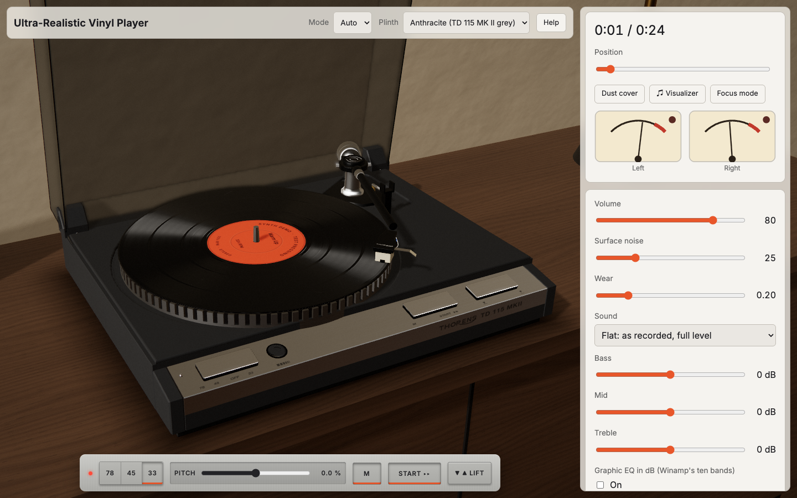
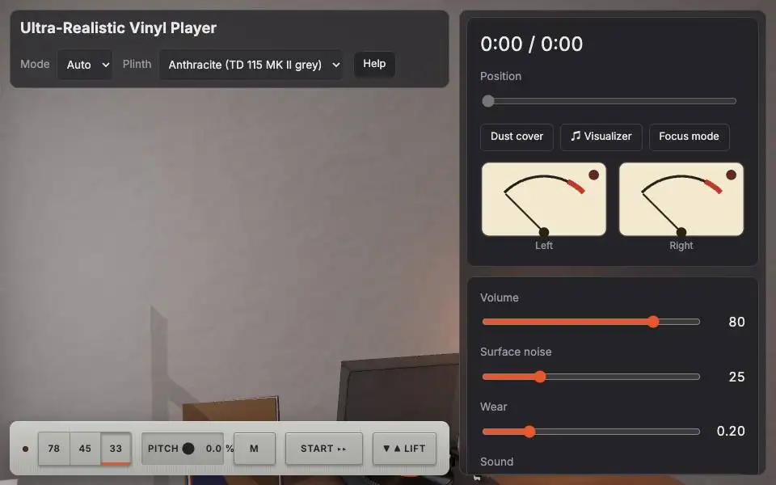
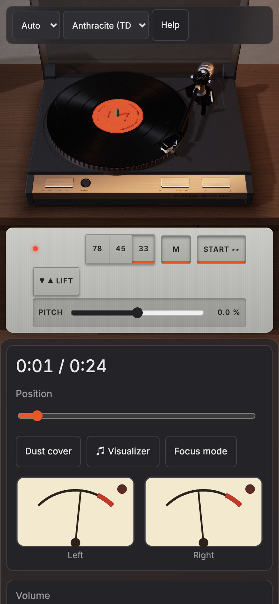
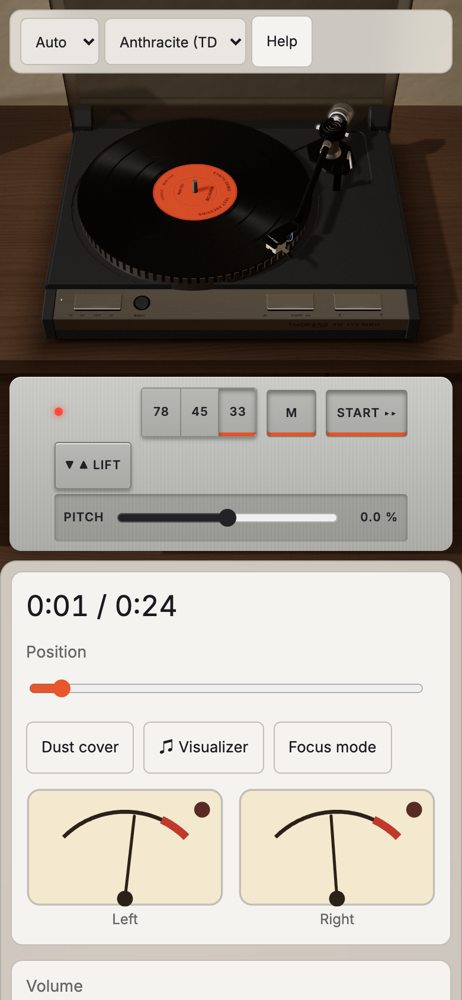
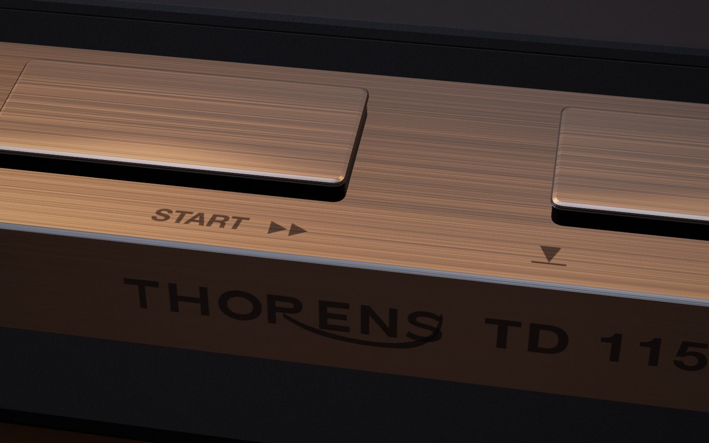

<div align="center">


# Ultra-Realistic Vinyl Player

**A Thorens TD 115 MK II in your browser: every part modelled in 3D from photographs, with a physically modelled motor, tonearm and playback chain.**

[Features](#features) · [Quick start](#quick-start) · [The deck](#the-deck) · [How the audio is wired](#how-the-audio-is-wired) · [FAQ](#faq)

[](LICENSE)


<picture>
  <source media="(prefers-color-scheme: dark)" srcset="docs/screenshots/desktop-dark.png">
  
</picture>

</div>

Load your own music and play it on a 3D model of a real 1980s belt-drive turntable. Drag the arm,
slide the speed plate, lift the dust cover, put a hand on the record. The strip reads `78 45 OFF 33`
because the real one does, and 78 stays locked until you press the pin beside it. Nothing leaves
your device.

The same source also builds one self-contained `index.html`, published as
[ultra-realistic-vinyl-player-html](https://github.com/Gitguy268/ultra-realistic-vinyl-player-html): every
feature, double-click to run, no server.

<div align="center">

</div>

|                                           Phone, dark                                           |                                           Phone, light                                            |                                                            Macro                                                             |
| :---------------------------------------------------------------------------------------------: | :-----------------------------------------------------------------------------------------------: | :--------------------------------------------------------------------------------------------------------------------------: |
|  |  |  |

<!-- live-links -->
**Live:** [gitguy268.github.io/ultra-realistic-vinyl-player](https://gitguy268.github.io/ultra-realistic-vinyl-player/) · [ultra-realistic-vinyl-player.vercel.app](https://ultra-realistic-vinyl-player.vercel.app)
<!-- /live-links -->

<!-- run-steps:start -->
## Run it locally, step by step

1. **Install [Node.js](https://nodejs.org) 22** or newer.

2. **Get the code:**

   ```sh
   git clone https://github.com/Gitguy268/ultra-realistic-vinyl-player.git
   cd ultra-realistic-vinyl-player
   ```

3. **Install the dependencies:**

   ```sh
   npm ci
   ```

4. **Start it:**

   ```sh
   npm run dev
   ```

5. **Open <http://localhost:5173/>** in your browser. Press `Ctrl+C` in the terminal to stop.
<!-- run-steps:end -->

## Features

| Feature                                                                                                 | Status                            |
| ------------------------------------------------------------------------------------------------------- | --------------------------------- |
| Real speed plate 33 / OFF / 45, with 78 behind its unlock pin; ±6 % pitch wheel, ±8 % as an option      | Shipped                           |
| Strobe slots in the rim, lit by a neon lamp: they stand still at exact speed (50 or 60 Hz mains)        | Shipped                           |
| Tonearm on its true pivot: drag to cue, damped cue plate, end stop, optional return                     | Shipped                           |
| The whole queue laid on one record: bands by length and loudness, gaps, lead-in, run-out, locked groove | Shipped                           |
| Sides of about 22 minutes that turn over in 3D; 12-inch, 7-inch on its adapter, 10-inch                 | Shipped                           |
| Scratching with a hand on the record, forward or backward, and silent scrubbing                         | Shipped                           |
| RIAA stage, wow and flutter, mono bass, crosstalk and roll-off of a cut record, in an AudioWorklet      | Shipped                           |
| Surface noise, Mint to Beat-up, with scratches that tick exactly as their drawn mark passes the stylus  | Shipped                           |
| Mechanical sounds for plates, cue, arm, motor, cover hinge and needle drop                              | Shipped                           |
| Winamp ten-band graphic EQ with 17 presets and .eqf import                                              | Shipped                           |
| Label visualizer: MilkDrop, bars, lines, scope, spectrogram, radial                                     | Shipped                           |
| Library in IndexedDB: file, folder and drag-and-drop import, tags, cover art, liner notes               | Shipped                           |
| Library desktop: artists and albums as folders, tracks to drag onto the deck                            | Shipped                           |
| Queue with shuffle, repeat, reordering, auto-advance; Media Session                                     | Shipped                           |
| Six finishes, daylight and dusk lighting, an acrylic cover on sprung hinges                             | Shipped                           |
| Camera: opening move, orbit within the room, focus view, four-stop tour                                 | Shipped                           |
| A 2D deck with every control when WebGL is missing; recovery when the GPU drops the context             | Shipped                           |
| Installable PWA that works offline, with an update prompt                                               | Shipped                           |
| Reduced motion, keyboard operation of every control, screen-reader announcements                        | Shipped                           |
| Scratching in streaming mode (files over 150 MiB or 20 minutes)                                         | Not possible with a media element |

## Quick start

Requires Node 22.12 or newer.

```sh
git clone https://github.com/Gitguy268/ultra-realistic-vinyl-player.git
cd ultra-realistic-vinyl-player
npm ci
npm run dev
```

Open the printed URL, press **Add files**, then **Start** (or drag the headshell
onto the record). `http://localhost:5173/?demo` plays three synthesized tracks without touching your
library.

To try the production build instead, `npm start` builds it, serves it and opens
it in your browser. Opening `index.html` directly as a file does not work: a
browser will not load the scripts, the audio worklet or the service worker from
a `file://` address, and the page says so.

## Commands

| Command                 | What it does                                   |
| ----------------------- | ---------------------------------------------- |
| `npm run dev`           | Start the Vite dev server                      |
| `npm run build`         | Type-check and build to `dist/`                |
| `npm run preview`       | Serve the production build on port 4183        |
| `npm start`             | Build, serve and open the production build     |
| `npm run typecheck`     | Type-check without building                    |
| `npm run lint`          | ESLint                                         |
| `npm run lint:fix`      | ESLint with automatic fixes                    |
| `npm run format`        | Format everything with Prettier                |
| `npm run format:check`  | Check formatting                               |
| `npm run test`          | Run the unit tests once                        |
| `npm run test:watch`    | Run the unit tests in watch mode               |
| `npm run check:links`   | Check links in the Markdown files              |
| `npm run check:browser` | Build and run every headless browser check     |
| `npm run verify`        | Lint, format check, type-check, test and build |

Headless browser checks live in `scripts/`. One command builds, serves the
build on port 4174 and runs them all:

```sh
npm run check:browser
```

<details>
<summary>The 23 browser checks</summary>

| Script               | What it checks                                                              |
| -------------------- | --------------------------------------------------------------------------- |
| `check-audio`        | The built worklet: clipping, response, wow and flutter, reverse             |
| `check-formats`      | Real WAV, FLAC, MP3, M4A and AIFF files: tags and playback                  |
| `check-deck`         | Transport, arm drag, scratching, noise controls                             |
| `check-parts`        | Each part turns about its real axis; interlock; closed cover blocks the arm |
| `check-sfx`          | Mechanism sounds, the Effects gate, the cut chain, ticks under drawn marks  |
| `check-modes`        | `?demo`, `?selftest`, the debug tap                                         |
| `check-storage`      | Each build's own storage, and html-1's data carrying over                   |
| `check-fallback`     | No WebGL: the 2D deck with working controls                                 |
| `check-context-loss` | The GPU takes the context away: music goes on, the scene comes back         |
| `check-network`      | Nothing leaves the origin; what loads later is precached                    |
| `check-reduced`      | No intro, drift, wobble or tremble                                          |
| `check-details`      | Pitch detent, 45 adapter, lamp parallax, side flip, lock-screen position    |
| `check-label`        | The printed label, its text, measured groove loudness                       |
| `check-drop-cover`   | Page-wide drop, a dropped image as the cover                                |
| `check-finishes`     | Each finish is its own material; Clear's translucent record                 |
| `check-mobile`       | Phone layout, touch transport, background routing                           |
| `check-visualizer`   | The ♫ button, each style on the label, the saved choice                     |
| `check-camera`       | Opening move, orbit limits, reframe, focus, tour, no scroll hijack          |
| `check-winamp`       | Graphic EQ and the library desktop                                          |
| `check-library`      | Folder import, persistence, queue, auto-advance, the cue-lever rule         |
| `check-keyboard`     | Tab order, shortcuts, focus mode, dialogs, themes                           |
| `check-loading`      | Fast track switching, streaming mode                                        |
| `check-offline`      | Service worker, offline reload, update prompt                               |

Run separately: `check-overlay` (geometry against the reference, needs a dev server on 4184),
`check-perf` (frame time and budgets), `check-soak` (ten minutes), `check-spec` (the two builds share
one spec), `check-filenotice` (needs both builds), `check-parity` (every row of
[docs/PARITY.md](docs/PARITY.md) names evidence that exists).

</details>

They use the Chromium that Playwright installs (`npx playwright install chromium`).
To run them in another engine, install it (`npx playwright install firefox webkit`)
and set `BROWSER` to `firefox`, `webkit` or `msedge`:

```sh
BROWSER=firefox npm run check:browser
```

## Deploying

The app is a static site. `vercel.json` sets the Vite framework preset and
`dist` as the output directory, so importing the repository into
[Vercel](https://vercel.com/docs/frameworks/frontend/vite) needs no further
configuration:

1. Import the repository in Vercel and keep the detected **Vite** preset.
2. Name the project `ultra-realistic-vinyl-player`.
3. Every push to `main` deploys to production. Every pull request gets its own
   preview deployment with a unique URL.

No environment variables are needed. Any static host works the same way: run
`npm run build` and serve `dist/` over HTTPS (service workers and AudioWorklet
need a secure context).

## The deck

The model was built from a graded set of 104 photographs. Each visible feature in
[docs/REFERENCE.md](docs/REFERENCE.md) names its grade-A evidence and the code that implements it,
and a unit test holds both to that. Proportions come from a solved camera over the overhead
photograph; `check-overlay` keeps 18 features within 2 % of the plinth width.

<details>
<summary>What is modelled, and what is only implied</summary>

Modelled: moulded top plate with its stepped arm board, brushed strip and silkscreen, plates with
polished bevels and black skirts, knurled pitch wheel, slotted zinc platter with a machined lip,
ringed rubber mat, gimbal with its ringed cap and screws, stepped counterweight, TP 30 wand, L-shaped
headshell with print, finger lift, tag wires and cartridge, smoked acrylic cover with tinted edges,
sprung hinges, rear panel and feet.

Not modelled: the sub-chassis springs, motor and belt under the plate. The platter does not lift, so
nothing below it is ever seen.

The wordmark is traced from a photograph of the real deck, and the deck's name and brand appear on
the model because this is a study of that object. Thorens is a trademark of its owner; this project
is not affiliated with it.

</details>

<details>
<summary>Performance, measured on an M-series Mac</summary>

At 1440 × 900: 134 scene draw calls, about 59k triangles, 92 MB of textures, 4.2 ms of real frame cost
(locked to 60 Hz in use). At 390 × 844 with DPR 2: 128 draw calls, 4.1 ms. With nothing moving for a
second the deck draws 4 frames a second. If frames average under 24 fps for two seconds the resolution
steps down. The arm's moving shadow redraws the shadow map, which adds about 200 calls for those frames
only. JavaScript is about 0.5 MB gzipped.

</details>

## How the audio is wired

```text
 decoded buffer source ─┐
 streaming <audio> ─────┼─► vinyl worklet ─► scrub ─► trim ► tone ► graphic EQ ─┬─► cut chain ─┐
 needle thunk ──────────┘   RIAA ► wow/flutter  (mute)      bass/mid/  10 bands  │ mono bass,   ├─► volume ─► analyser ─► output ─► speakers
                            + scratch ticks, pops           treble               │ crosstalk,   │     ▲                  or a <audio> sink
                            owns the record's angle                              │ roll-off,    │     │
                                                                                 │ saturation   │     │
                                                                                 └─ bypass ─────┘     │
 surface noise, shellac grit, motor rumble ───────────────────────────────────────────────────────────┘
 meters tap after the EQ, ahead of the saturation
 plate, cue, arm, motor and hinge sounds ─► their own volume ─────────────────────────────► output
 cue lever clack ──────────────────────────────────────────────────────────────────────────────────► speakers
```

- Everything that comes off the record goes through the worklet, which also holds the record's true
  angle. The drawn record locks to it, so a scratch's mark passes the stylus as its tick sounds.
- The record is cut at 33⅓: a side's grooves are timed by the record itself, so pitch, spin-up and a
  hand on the record all change what you hear the same way.
- Surface noise joins after the worklet. Routed through it, the RIAA bass boost would turn hiss into
  rumble. Its speed follows the record, and it falls silent when the record stops.
- The trim takes the EQ preamp and turns the music down by the largest boost the controls add, so
  nothing clips. The Deck setting **Record character** bypasses the cut chain for a truly flat signal.
- The pure maths (RIAA, wow and flutter, motor, strobe, arm geometry, record layout, wear, queue) lives
  in modules without DOM or Web Audio dependencies, is unit-tested, and is what the worklet imports.

## FAQ

**Why does a big file say "streaming mode"?**
Files up to 150 MiB and 20 minutes are decoded fully into memory, which allows sample-accurate
seeking and scratching. Anything larger would need gigabytes of RAM decoded, so
it plays through an `<audio>` element instead. Speed and pitch still follow
the motor; scratching is disabled for that track.

**How accurate is the RIAA curve?**
The filter uses the standard playback time constants (3180, 318 and 75 µs). At
a 48 kHz sample rate it stays within 0.3 dB of the ideal curve up to 2 kHz and
within 0.7 dB at 10 kHz. Above that the simple digital filter runs out of room
before the Nyquist frequency and cuts less treble than it should: about 2.7 dB
too little at 20 kHz (3.2 dB at 44.1 kHz). The unit tests pin these numbers.

**What do the two Sound modes do?**
A real record is cut with the inverse of the RIAA playback curve, and the phono
stage undoes it, so the music comes out as it was recorded.

- **Flat** (the default) models exactly that: music passes at full level and
  only sounds made at the stylus, such as the thump of the needle landing, are
  shaped by the curve.
- **Warm** applies the playback curve to the music itself, as if a digital file
  were fed straight into a phono input. Bass is boosted (about +13 dB at
  100 Hz) and treble cut, and the stage runs 19.9 dB down so that even a
  full-scale bass note cannot clip. It is therefore much quieter.

**Can the tone controls or the noise make it clip?**
The levels are budgeted. Music is turned down by exactly the room the surface
noise needs (0.7 dB at the default setting) and by the largest boost the Bass,
Mid and Treble controls apply together, so a full-scale sine stays at or under
full scale with everything turned up. Two things are outside that budget: the
needle and lever sounds, and edges sharper than real music has, which the wow
and flutter interpolation can overshoot by about 1 dB.

**What are wow and flutter here?**
Slow (0.73 Hz) and fast (6.7 Hz) speed wobble, each made of two sine waves with
an irrational frequency ratio so the pattern never repeats exactly. Peak
deviation is 0.12 % and 0.05 %. It is applied with a modulated delay line of
about 5 ms. Untick **Wow and flutter** to switch it off.

**What are the limits of scratching?**
It needs decode mode (files up to 150 MiB), and it keeps one extra copy of the
decoded audio on the audio thread, roughly 21 MB per stereo minute at 44.1 kHz,
sent once per track on the first scratch. Samples are interpolated linearly, so
very slow or very fast hand movement sounds rougher than real vinyl. Scratching
past either end of the track wraps around.

**How close is it to the real turntable?**
Close in shape and controls, with a few deliberate differences, all recorded in
[docs/PARITY.md](docs/PARITY.md):

- Pitch is ±6 % as on the real deck; **Extended pitch** gives the ±8 % of the earlier players.
- The ⏻ twin and the `M` key slide the speed plate to OFF and back.
- In START the end stop lifts the arm and stops the motor, as the real deck does. Swinging back to the
  rest is an extra, on by default.
- The slots stand still at 33⅓ under the lamp, as on the real rim. The adapter's marks serve 45, and
  there is no strobe at 78.

**What does clicking a track do?**
With the cue lever down it plays. With the lever raised it is only cued up, and the arm hovers until
you lower it.

**Which browsers work?**
Current Chrome, Edge, Firefox and Safari (17.5 or newer, for the CSS
`light-dark()` function). The 3D deck needs WebGL 2; without it the 2D deck takes over. The app also
needs AudioWorklet, IndexedDB and Canvas 2D.
Picking a folder uses the File System Access API where it exists and a
directory file input elsewhere. Which audio formats decode depends on the
browser. This app's browser checks run in Chromium on macOS, with a real GPU. The same code, as the
single file, passes html-1's test suite in Chromium and Firefox and all but one assertion in WebKit, whose
frame time misses the 20 ms target at the 95th percentile (20 to 21 ms). WebKit is close to Safari but is not Safari,
and no real phone has been tested: phone layouts are checked by emulation.

**What happens to my files?**
Nothing leaves the device. There is no server, account, analytics or third-party
request. Imported audio is stored in your browser's IndexedDB, and the queue
order and settings in `localStorage`. **Clear library** removes the audio; the
files on your disk are never modified.

## More

- [Contributing](CONTRIBUTING.md) — code style, commit rules, manual test matrix
- [Security policy](SECURITY.md)
- [Code of conduct](CODE_OF_CONDUCT.md)
- [License](LICENSE) (MIT)
- [Third-party notices](NOTICE)
- [Changelog](CHANGELOG.md)
